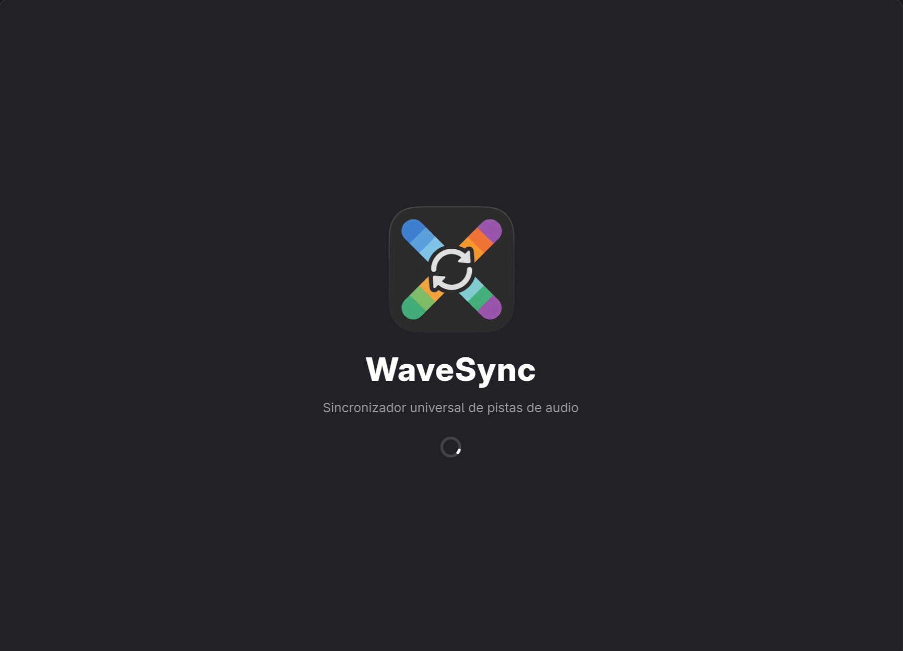

<div align="center">
  

  <h1>WaveSync</h1>

  <p>
    <strong>Universal Audio Track Synchronizer for Video</strong><br>
    <em>Sub-millisecond automated audio synchronization across cuts, framerate conversions, and dubs without re-encoding video.</em>
  </p>

  <p>
    <a href="https://www.python.org/"></a>
    <a href="https://www.gtk.org/"></a>
    <a href="https://gnome.pages.gitlab.gnome.org/libadwaita/"></a>
    <a href="https://gstreamer.freedesktop.org/"></a>
    <a href="https://www.gnu.org/licenses/gpl-3.0.html"></a>
  </p>

  <p>
    <a href="#-how-it-works">How It Works</a> •
    <a href="#-key-features">Key Features</a> •
    <a href="#-installation">Installation</a> •
    <a href="#-cli-usage">CLI & Batch</a> •
    <a href="#-keyboard-shortcuts">Shortcuts</a>
  </p>

  
</div>

---

## 🎯 Overview

**WaveSync** is a modern Linux desktop application built with **Python 3.11+, GTK 4, and Libadwaita**. It extracts the audio track from a secondary video or audio release (**Source B**, in any language or dub) and **automatically synchronizes it with sub-millisecond precision** into a high-quality master release (**Master A**, e.g., 4K UHD Remux, HDR/Dolby Vision), **without re-encoding the video stream**.

Whether you are dealing with PAL speedups ($25 \leftrightarrow 23.976\text{ fps}$), missing studio logos, censorship trims, theatrical vs. extended cuts, or multi-language dubs, WaveSync calculates the exact time offset and tempo corrections required, lets you audit the alignment via an interactive live A/B comparator, and muxes a clean MKV/MP4 container.

---

## ⚙️ How It Works

Unlike tools that rely on speech recognition or AI voice models, WaveSync uses a **100% language-independent signal processing pipeline**:

1. **Stage 1 — Primary Video Alignment:** Auto-crops black letterbox bars (`detect_borders`) and extracts distributed $32 \times 32$ grayscale thumbnail windows. Each frame is processed via **rank-order normalization** (`rankdata` + z-score) with corner-masking to ignore watermarks and channel logos. This guarantees mathematical invariance to brightness, contrast, gamma, and HDR-to-SDR tone-mapping differences.
2. **Stage 2 — Sub-Millisecond Audio Refinement:** Applies **GCC-PHAT** (Generalized Cross-Correlation with Phase Transform) with sub-sample parabolic peak interpolation. By applying voice-band attenuation ($300\text{--}3400\text{ Hz}$) or side-channel extraction ($L - R$), it locks onto shared background music, foley, and ambient effects that remain identical across international dubs. Refinement is constrained within $\pm 40\text{ ms}$ of the visual anchor.
3. **Stage 3 — Cut & Framerate Detection:** Evaluates $\ge 20$ distributed sampling windows, models linear tempo drift using **RANSAC** (snapping to standard industry ratios: $25 \leftrightarrow 23.976 \leftrightarrow 24\text{ fps}$), and pinpoints structural cut boundaries via frame-accurate step segmentation.

---

## ✨ Key Features

* **🎧 Live A/B Comparator & Calibration:**
  * **Zero-Latency Switching:** Powered by **GStreamer (`playbin` + `gtk4paintablesink`)** with shared pipeline clocks for instant, gapless toggling between Master Audio A and Synchronized Audio B.
  * **Micro-Precision Controls:** Interactive fine-tuning for offset ($-10,000$ to $+10,000\text{ ms}$ in $1\text{ ms}$ steps) and tempo multiplier ($6$ decimal places).
  * **Pitch Correction Modes:** Choose between `atempo` (preserves original pitch) and `asetrate+aresample` (corrects the $+4\%$ pitch shift caused by PAL speedup).
* **🌍 Comprehensive Metadata & ISO 639-2:**
  * Instant search across all **487 ISO 639-2 (/B and /T)** language codes with localized and native endonyms, custom tag support, and full Unicode track titles (`Castellano`, `English (Original)`, `日本語`, `Français (VF)`, `Українська`, `العربية`).
* **🛡️ Lossless & Verified Export:**
  * **Bit-Perfect Video:** Direct stream copy for video, subtitles, chapters, and master audio tracks (`-c:v copy -c:s copy`).
  * **Format Flexibility:** Default MKV output (optional MP4 container).
  * **Safe Atomic Write:** Exports to a hidden temporary file in the target directory, performs an atomic filesystem replacement (`os.replace`), and validates output integrity via `ffprobe`.
* **📦 Multi-File Batch Workflow:**
  * Synchronize entire TV seasons or movie collections in one go via the GUI Batch Manager or a headless JSON CLI pipeline.
* **🌐 Multi-Language UI:**
  * Native interface available in **English**, **Spanish** (Español), and **Catalan** (Català), switchable on the fly in *Preferences → Language*.

---

## 🚀 Installation

### 1. System Dependencies

WaveSync requires **GTK 4**, **Libadwaita**, **GStreamer 1.0** (with GTK4 plugin), and **FFmpeg**.

<details open>
<summary><b>Fedora (40+)</b></summary>

```bash
sudo dnf install -y \
    python3 python3-pip python3-devel python3-gobject python3-numpy python3-scipy \
    gtk4 libadwaita \
    gstreamer1 gstreamer1-plugins-base gstreamer1-plugins-good \
    gstreamer1-plugins-bad-free gstreamer1-plugins-ugly-free \
    gstreamer1-plugin-libav gstreamer1-plugin-gtk4 \
    ffmpeg
```
</details>

<details>
<summary><b>Debian 12+ / Ubuntu 24.04+</b></summary>

```bash
sudo apt update && sudo apt install -y \
    python3 python3-venv python3-pip python3-gi python3-gi-cairo python3-numpy python3-scipy \
    gir1.2-gtk-4.0 gir1.2-adw-1 gir1.2-gst-plugins-base-1.0 gir1.2-gstreamer-1.0 \
    gstreamer1.0-plugins-base gstreamer1.0-plugins-good gstreamer1.0-plugins-bad \
    gstreamer1.0-gtk4 gstreamer1.0-libav \
    ffmpeg
```
</details>

<details>
<summary><b>Arch Linux</b></summary>

```bash
sudo pacman -S --needed \
    python python-pip python-gobject python-cairo python-numpy python-scipy \
    gtk4 libadwaita \
    gstreamer gst-plugins-base gst-plugins-good gst-plugins-bad gst-plugins-ugly \
    gst-plugin-gtk4 gst-libav \
    ffmpeg
```
</details>

### 2. Setup & Launch

```bash
# 1. Clone the repository
git clone https://github.com/unaibenidorm/WaveSync.git
cd WaveSync

# 2. Create a virtual environment (inheriting system PyGObject/GTK4 bindings)
python3 -m venv --system-site-packages .venv
source .venv/bin/activate

# 3. Install Python dependencies
pip install -r requirements.txt

# 4. Launch WaveSync GUI
PYTHONPATH=src python -m wavesync
```

---

## 💻 CLI Usage

WaveSync includes a full headless CLI for servers, NAS environments, and automated scripts.

*(Assuming your `.venv` is activated and `export PYTHONPATH=src` is set)*:

```bash
# Inspect audio/video streams in media files
python -m wavesync.core.cli probe master_4k.mkv dub_source.mp4

# Calculate sync offset and tempo drift without exporting
python -m wavesync.core.cli analyze master_4k.mkv dub_source.mp4

# Analyze and mux a synchronized release directly
python -m wavesync.core.cli sync master_4k.mkv dub_source.mp4 \
    -o output_dual.mkv --lang spa --title "Spanish Dub" --default

# Process multiple files from a JSON batch manifest
python -m wavesync.core.cli batch movies.json \
    --output-dir /media/output --codec aac -y
```

### JSON Batch Manifest Example (`movies.json`)

```json
[
  {
    "master": "/media/Movie1_UHD.mkv",
    "source": "/media/Movie1_Dub.mp4",
    "output": "/media/output/Movie1_Dual.mkv",
    "source_track": 0,
    "lang": "spa",
    "title": "Castellano 5.1"
  },
  {
    "master": "/media/Movie2_UHD.mkv",
    "source": "/media/Movie2_Dub.mkv",
    "source_track": 1,
    "lang": "cat",
    "title": "Valencià Stereo"
  }
]
```

---

## ⌨️ Keyboard Shortcuts

| Shortcut | Context | Action |
| :--- | :--- | :--- |
| <kbd>Space</kbd> | A/B Comparator | Play / Pause playback |
| <kbd>Tab</kbd> or <kbd>B</kbd> | A/B Comparator | Toggle active audio between **Track A** and **Track B** |
| <kbd>←</kbd> / <kbd>→</kbd> | A/B Comparator | Seek $-5\text{ s}$ / $+5\text{ s}$ |
| <kbd>Shift</kbd> + <kbd>←</kbd> / <kbd>→</kbd> | A/B Comparator | Fine seek $-1\text{ s}$ / $+1\text{ s}$ |
| <kbd>Ctrl</kbd> + <kbd>,</kbd> | Global | Open Preferences |
| <kbd>Ctrl</kbd> + <kbd>H</kbd> | Global | Open Synchronization History |
| <kbd>Ctrl</kbd> + <kbd>Q</kbd> | Global | Quit application |

---

## 📄 License

WaveSync is free and open-source software licensed under the **GNU General Public License v3.0 or later** ([GPL-3.0-or-later](https://www.gnu.org/licenses/gpl-3.0.html)).

<p align="center">
  Developed with ❤️ by <a href="https://github.com/unaibenidorm">unaibenidorm</a>
</p>